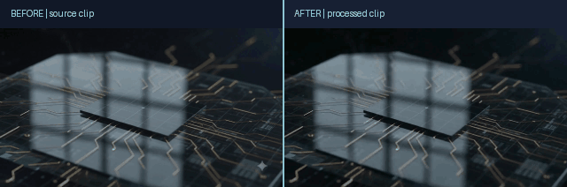

# RenderFix

RenderFix is a local desktop media app with video frame tools, OpenCV video cleanup, and optional AI image and video features. The interface is built with React and Electron; its local processing service uses Python.

## Features

- Export frames, video clips, and GIFs.
- Remove a video region with the fast OpenCV method.
- Optionally use ProPainter for temporal video inpainting.
- Edit images, remove backgrounds, segment objects, and use generative image tools.

## Platform and GPU support

The desktop shell can be developed on Windows, but **full Windows AI support is not implemented yet**. Several AI endpoints in `backend/server.py` explicitly move models and tensors to Apple's `mps` device. The app does not currently select CUDA for NVIDIA GPUs or provide a tested ROCm path for AMD GPUs.

| System | Current status |
| --- | --- |
| macOS on Apple silicon | The current packaged build targets Apple silicon. The AI code uses PyTorch MPS. |
| macOS on Intel | No current Intel build is provided; the MPS-based AI paths are not supported on Intel Macs. |
| Windows with NVIDIA GPU | Experimental source setup only. CUDA acceleration is not wired into the current AI code. Basic CPU video tools may work. |
| Windows with AMD GPU | No tested AMD/ROCm path. Treat this as CPU-only for basic video tools. |
| Windows with integrated graphics or CPU only | Basic video tools may run on the CPU; AI image features and ProPainter are not supported as a complete workflow. |

The Windows steps below are for trying the source version and basic CPU video tools. They do not imply that all AI features work on Windows. Installing a CUDA-enabled PyTorch wheel alone will not enable NVIDIA acceleration until the backend has CUDA device selection. AMD GPU support also needs separate implementation and testing.

## Hardware and storage planning

RenderFix does not yet have formally measured minimum specifications. Use these as planning estimates:

| Use | Practical starting point |
| --- | --- |
| Basic editing and CPU video tools | 64-bit Windows or macOS, a recent 4-core CPU, 8 GB RAM, and about 5 GB free disk space for source and dependencies. More RAM and space are useful for longer clips. |
| Local AI features | 16 GB RAM is a practical target; 32 GB is more comfortable for large media and multiple models. On Apple silicon, 16 GB or more unified memory is recommended. |
| Future Windows AI acceleration | NVIDIA CUDA is the most realistic first target; plan for 8 GB or more VRAM, with 12 GB or more preferred. This is a target for future support, not a promise for the current Windows build. AMD GPUs are not currently supported by this app's AI backend. |
| Full local model setup | Reserve about 25 GB free, plus extra space for source videos, extracted frames, and exports. Model downloads and temporary processing files can increase this. |

On the current development machine, the backend Python environments take about 3.2 GB combined, and the downloaded Hugging Face model cache is about 14 GB. Those figures vary by operating system, package versions, and which models are used; they are not exact minimums.

## Before and after sample

<p align="center">
  
</p>

Full clips: [before](docs/media/before.mp4) · [after](docs/media/after.mp4)

This is the sample input/output pair currently available in the project. The clips look nearly identical, so this example demonstrates the side-by-side comparison layout, not a clearly successful cleanup or a guaranteed result. Video removal quality depends on the mask, footage, and processing method.

## Run from source

### Prerequisites

- Node.js 22 LTS and npm.
- Python 3.11 recommended for the backend environment.
- Git and internet access for optional model downloads.

### macOS on Apple silicon

From the project folder, install the frontend dependencies:

```bash
cd frontend
npm install
```

In another terminal, install the backend environment:

```bash
cd backend
python3.11 -m venv .venv
source .venv/bin/activate
python -m pip install --upgrade pip
python -m pip install -r requirements.txt
python -m pip install insightface onnxruntime
```

Start the desktop app from the `frontend` folder:

```bash
npm run desktop
```

Electron starts the local Python backend automatically. The first use of AI features may download several model files.

### Windows 10/11 x64 (experimental, basic CPU workflow)

Install Node.js 22 LTS and Python 3.11 first. Open PowerShell in the project folder and install the frontend:

```powershell
cd frontend
npm install
```

Create the backend environment and install its Python packages:

```powershell
cd ..\backend
py -3.11 -m venv .venv
.\.venv\Scripts\python.exe -m pip install --upgrade pip
.\.venv\Scripts\python.exe -m pip install -r requirements.txt
```

Start RenderFix:

```powershell
cd ..\frontend
npm run desktop
```

This setup may run the basic OpenCV video tools on the CPU. The current AI image paths use `mps`, so segmentation and generative AI features are not expected to work on Windows. The ProPainter setup script is also written for Bash and has not been adapted or validated for Windows.

#### GPU notes for Windows

- **NVIDIA:** The current code does not route AI models to CUDA. Do not expect a CUDA GPU to accelerate the app yet. When CUDA support is added, install PyTorch using the [official PyTorch selector](https://pytorch.org/get-started/locally/) so the package matches the supported Python and CUDA combination.
- **AMD Radeon:** There is no tested ROCm integration in RenderFix. Basic video operations may use the CPU; AI GPU acceleration is not supported.
- **Integrated graphics or CPU only:** Use the basic video tools as an experimental CPU workflow. AI features may fail or be impractically slow.

### Optional temporal video inpainting (macOS/Linux only)

From the `backend` folder, install ProPainter and its checkpoints:

```bash
bash ./setup_propainter.sh
```

Restart RenderFix, choose **Temporal · ProPainter**, draw a mask, then export. This method can take substantially longer than OpenCV. The project processes a context crop with a maximum edge of 384 pixels and keeps the source audio.

ProPainter code and model weights use the [S-Lab License 1.0](https://github.com/sczhou/ProPainter/blob/main/LICENSE), which permits redistribution and use for non-commercial purposes under its terms. Review the license before using or distributing this mode.

## macOS app bundle

Build the Apple silicon app bundle with:

```bash
cd frontend
npm run package:mac
```

The app bundle is created at `frontend/release/mac-arm64/RenderFix.app`. This local package still points to the backend and model files in the project folder; keep that folder in place. It is not a self-contained public installer.

### Updating an installed app after code changes

The current app does **not** have an automatic updater. The packaged frontend and Electron shell are snapshots from the last build. After changing UI or Electron code, rebuild with `npm run package:mac`, then replace the copy in `/Applications` with the new app bundle.

The packaged app starts its Python backend from the project folder. If you change only backend Python files and keep that folder in place, quitting and reopening the app will use those backend changes. UI changes still require rebuilding and replacing the app. Automatic updates would need a signed release build, update hosting, and updater code added to the app.
